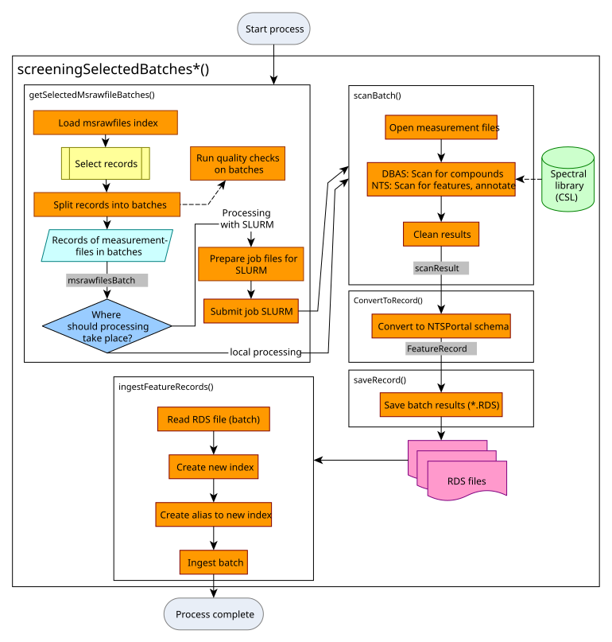
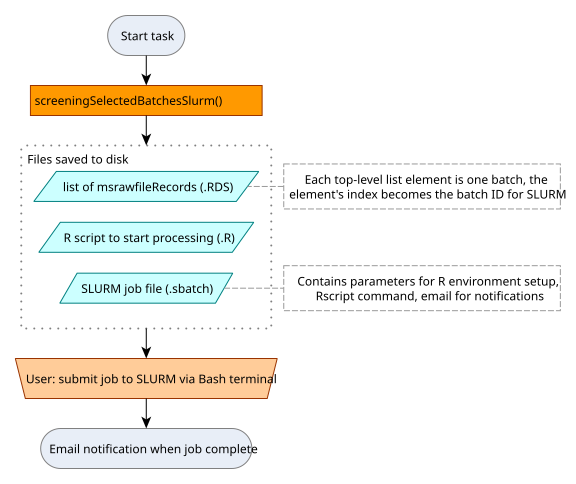
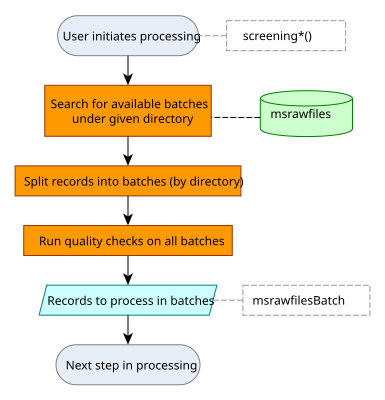

```{r, include = FALSE}
knitr::opts_chunk$set(
  collapse = TRUE,
  comment = "#>"
)
```

# Introduction

Measurement files are processed using the library screening algorithm known as DBAS (database assisted screening), described here, or the  [non-target screening](articles/processing-by-non-target-screening.html) algorithm. All the parameters for processing, as well as the location of the necessary input files, are stored in the `msrawfiles` table of NTSPortal. The output of processing is stored in a `feature` table. See [naming conventions of indices](articles/structure-and-table-naming.html).

# Starting the (re)processing of measurement files

Processing measurement files using the screening algorithms `dbas` or `nts` is started by the user using either with [`screeningSelectedBatches()`](reference/screeningSelectedBatches.html) or, if the processing is to be done via the SLURM workload manager [`screeningSelectedBatchesSlurm()`](reference/screeningSelectedBatchesSlurm.html). For example, after additions have been made to the spectral library (CSL) all measurement files are reprocessed with the new CSL version. After making necessary changes to the `spectral_library_path` field in the `msrawfiles` table, processing can be started with the aforementioned functions. The results of processing are saved as `.RDS` files. After processing is complete,  `ingestFeatureRecords()` is used to upload the data to NTSPortal.

The following provides further technical detail regarding the internal implementation of these functions.

# Internal implementation of the processing algorithm

## General workflow

The HRMS measurement files are stored as mzXML files in the filesystem, in directories representing batches (measurement sequences). The files were previously converted from the vendor specific formats (.raw, .wiff, etc.) using *Proteowizard's* `msconvert`-tool. 

The `msrawfiles` table is used to manage the metadata. Each measurement file has a record in this table which contains information such as the file's path, sampling and acquisition information as well as processing parameters. The `msrawfilesRecord`s (sorted into `msrawfilesBatch`es) are used to control the processing workflow.

{width=100%}

### Process launching {#sec-process-launching}

The user runs one of two `screeningSelectedBatches*()` [functions](reference/index.html#screening-modules) to start the processing either locally or via SLURM. Specific directories (i.e. batches) containing the measurement files are passed either by listing them directly or by giving a root directory. `dbas` is the default `screeningType` in these functions. For further details on how batches are selected for processing, see Section [Collecting msrawfile records](#collecting-msrawfile-records).

#### Processing using the workflow manager SLURM

To run the screening via SLURM, first the necessary job files are be created. The user then starts the processing by submitting the job file (.sbatch) to the workload manager via the `sbatch` command in a BASH terminal.

{width=80%}

### Collecting msrawfile records {#sec-collecting-msrawfile-records}

The `msrawfilesRecord`s are fetched from Elasticsearch (`msrawfiles` table) and organized into batches. Checks are performed on the both the records and the batches. The Output is a `list` of `msrawfilesBatch` objects. 

{width=50%}

### File-wise scanning
`msrawfilesBatch` has subclasses for each processing type. The object type directs the workflow to the correct processing method. For example, a `dbasMsrawfilesBatch` is processed by the DBAS (library screening) method using the `scanBatch()` generic. In this method, the measurement files are scanned for compounds in the collective spectral library (CSL) and the results are cleaned, for example via blank correction. The result is one `dbasResult` object for the batch (`list` of `data.frame`s containing peak information for the whole batch). 

Table: `dbasResult` class

|Name of table|Comment|
|-------------|--------|
|`peakList`|Peaks detected with MS2|
|`reintegrationResults`|Peaks detected after gap-filling (with and without MS2)|
|`rawFilePaths`||
|`ms1Table`|MS spectra|
|`ms2Table`|MS2 spectra|
|`eicTable`|Extracted ion chromatograms|
|`isResults`|Internal standard peaks|


### Conversion to `featureRecord`

The results from scanning (`dbasResult`) are converted to a `featureRecord` format for import into NTSportal. Additional compound information is taken from the spectral library. MS^1^, MS^2^ spectra and the EIC of the peak are added if available (only peaks in `dbasResult$peakList` have these data available).

{width=100%}

### Writing RDS for database import

The list of `featureRecord` objects from one batch are saved in an RDS file (which uses the default `gzip` compression). 

### Database import (ingest)

Before ingesting documents, the user must ensure that the enrich policies and ingest pipelines are up to date. This is done with `updateEnrichPolicies()`, which will synchronize Elasticsearch with the current enrich policies and ingest pipelines needed.

The RDS files are imported into NTSPortal with `ingestFeatureRecords()`, which calls the Elasticsearch bulk ingest API via Python. The user runs `ingestFeatureRecords()` separately after processing is complete. The ingest includes a pipeline (`ingest-feature`) which enriches each document with sample metadata found in `msrawfiles`. These are the fields such as sampling location and sampling time, `loc` and `start` fields, respectively. 

{width=100%}

<!-- Copyright 2026 Bundesanstalt für Gewässerkunde -->
<!-- This file is part of ntsportal -->
